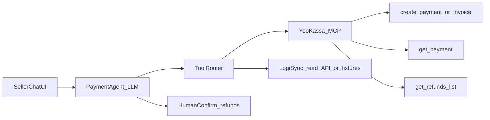

# LogiSync Payment Agent

ИИ-агент платежей для продавца LogiSync на **MCP ЮKassa**.

Участие в хакатоне [«Агентизация платежей с MCP ЮKassa»](https://promo.yookassa.ru/mcphackaton)  
**Трек 1:** «Сделайте свой бизнес агентным»  
**Окно разработки:** 5–6 декабря 2026 (МСК)  
**Статус:** подготовка репозитория. Код агента пишется **только в окне хакатона** (с 12:00 05.12).

Связанный продукт (контекст бизнеса, **не** артефакт сдачи): [Gfermoto/LogiSync](https://github.com/Gfermoto/LogiSync).

---

## Зачем

Продавец маркетплейса не должен открывать кабинет ЮKassa руками на каждый кейс:

- доплата за негабарит / доставку;
- счёт покупателю;
- проверка «оплачено → можно отгружать»;
- сверка возвратов ЮKassa ↔ очередь LogiSync.

Агент с LLM сам решает шаг и вызывает **MCP ЮKassa**. Рискованное (возврат денег) — только с подтверждением человека. Через MCP возврат создать нельзя — только читать.

---

## Фиксированные решения

| Решение | Выбор |
|--------|--------|
| Трек | 1 — агент внутри существующего бизнеса LogiSync |
| Сдача жюри | **этот** репозиторий (агент + UI + доки), не монорепо LogiSync |
| UI демо | FastAPI + простой чат в браузере |
| Платежи | только `https://mcp.yookassa.ru` + Bearer **MCP-токен** |
| LLM | OpenAI-compatible (`OPENAI_API_KEY`, опционально `OPENAI_BASE_URL`) |
| Контекст заказов | фикстуры и/или read-only API LogiSync |
| Права | п. 7.3 Правил — права на результат задания у Организатора → ядро LogiSync сюда не кладём |

Классический API ЮKassa в LogiSync (подписка платформы) — только фон для питча. В демо агента ключевые вызовы — **MCP**.

---

## Архитектура (цель на окно хакатона)



- **LLM** — выставить оплату / проверить статус / сверить возврат / эскалировать.
- **MCP** — исполняет платёжные действия.
- **LogiSync** — бизнес-контекст (заказ, доплата).
- **Человек** — подтверждает только рискованное.

---

## MVP-сценарий защиты

Один сквозной сюжет, не весь кабинет:

**Доплата / счёт → ссылка → проверка оплаты → сверка возврата**

1. Продавец: «По заказу X нужна доплата 790 ₽ за негабарит» (или кейс из фикстуры).
2. LLM → MCP `create_payment` или `create_invoice` → ссылка + `payment_id` в сессии.
3. «Проверь оплату» → MCP `get_payment` → при `succeeded`: «можно отгружать».
4. Сложный кейс: «Сверь возвраты» → MCP `get_refunds_list` + сравнение с фикстурой/LogiSync → расхождение и рекомендация, **без автовозврата денег**.

Метрики для слайда (тестовые данные ок): секунды до ссылки, шаги без кабинета ЮKassa, клики вручную vs агент.

---

## Расписание окна (МСК)

### 5 декабря

| Время | Действие |
|------|----------|
| 11:00–12:00 | Открытие; проверить, какие MCP tools есть в тестовом магазине (invoice?) |
| 12:00–14:00 | FastAPI чат, клиент MCP (Streamable HTTP + Bearer), обёртки `create_payment` / `get_payment` / `get_refunds_list` |
| 14:00–16:30 | LLM tool-calling + system prompt + сессия (`payment_id`, `order_id`) |
| 16:30–18:00 | E2E сценарий 1–3 на тестовом магазине; фикстуры |
| 18:00–19:00 | Доки, `scripts/demo_smoke.py`, **предпросмотр материалов** |
| после 19:00 | Видео 60–90 с запасным планом; полировка промпта |

### 6 декабря

| Время | Действие |
|------|----------|
| до 12:00 | Финальная сдача: репо + доки + презентация + короткое демо |
| 12:30+ | Защита: живой чат → MCP create → get → refunds; слайд «как другой клиент подключает токен» |

Коммиты — атомарные и частые **в эти даты** (критерий жюри).

---

## Структура репозитория (цель)

```
logisync-payment-agent/
  README.md
  .env.example
  .gitignore
  docs/PITCH.md
  docs/SETUP_OTHER_MERCHANT.md
  app/main.py              # FastAPI + /chat + static UI   ← с 05.12
  app/mcp_yookassa.py      # клиент MCP                   ← с 05.12
  app/agent.py             # LLM + tools                  ← с 05.12
  app/logisync_context.py  # read-only API / fixtures     ← с 05.12
  fixtures/orders.json
  scripts/demo_smoke.py
```

Сейчас в репо: план, `.env.example`, черновики доков и каркас каталогов. **Приложения агента ещё нет** — намеренно.

---

## Чеклист до 5 декабря (не код агента)

- [ ] Заявка на хакатон, трек 1: *«ИИ-агент платежей внутри LogiSync: доплаты, счета, сверка возвратов через MCP ЮKassa»*
- [ ] Тестовый магазин ЮKassa → MCP-токен → только локальный `.env` (не в git)
- [ ] В Cursor/Claude: `tools/list` видит `create_payment`, `get_payment`, `get_payments_list`, `get_refund` / `get_refunds_list` (+ `create_invoice`, если доступно)
- [ ] Этот репозиторий публичный, без секретов
- [ ] Черновик питча: [docs/PITCH.md](docs/PITCH.md)
- [ ] Слайд «другой клиент»: [docs/SETUP_OTHER_MERCHANT.md](docs/SETUP_OTHER_MERCHANT.md)
- [ ] 2–3 фикстурных кейса (суммы, `order_id`) под скрипт защиты

---

## Что не делаем

- Не переписываем биллинг подписки LogiSync на MCP.
- Не тащим Ozon / СДЭК / очередь отгрузок в демо как «фичу ЮKassa».
- Не коммитим MCP-токен, shop secret, JWT.
- Не сдаём монорепо LogiSync.
- Не обещаем создание возврата через MCP.
- Не пишем код агента до **12:00 05.12.2026 МСК**.

---

## Переменные окружения

Скопируйте `.env.example` → `.env` и заполните локально:

| Переменная | Назначение |
|-----------|------------|
| `YOOKASSA_MCP_TOKEN` | Bearer-токен MCP (не shopId / secret API) |
| `YOOKASSA_MCP_URL` | по умолчанию `https://mcp.yookassa.ru` |
| `OPENAI_API_KEY` | ключ LLM |
| `OPENAI_BASE_URL` | опционально, совместимый endpoint |
| `OPENAI_MODEL` | модель с tool-calling |
| `LOGISYNC_BASE_URL` | опционально, read-only контекст |
| `LOGISYNC_TOKEN` | опционально, не коммитить |

---

## Критерии жюри → как закрываем

| Блок | Макс | Как |
|------|------|-----|
| Бизнес и продукт | 35 | реальная боль seller-ops, узкий MVP |
| Технологии | 26 | отдельный репо, доки, коммиты 5–6.12, MCP по делу |
| MCP, агентность, автономность | 20 | несколько tools в цикле; create/get автономно; возвраты — человек |
| Презентация | 15 | живой чат + сложный кейс сверки |
| ИИ-судья кода | 4 | простой код, секреты только в env |

---

## Запуск (после окна хакатона)

Инструкции появятся здесь 05.12 вместе с кодом. Ожидаемо:

```bash
python -m venv .venv && source .venv/bin/activate
pip install -r requirements.txt
cp .env.example .env   # вставить токены локально
uvicorn app.main:app --reload --port 8080
```

---

## Ссылки

- Хакатон: https://promo.yookassa.ru/mcphackaton  
- Правила: https://yoomoney.ru/document/xakaton-agentizaciya-platejeie-s-mcp-yookassa  
- MCP ЮKassa: https://yookassa.ru/developers/payment-acceptance/integration-scenarios/mcp-server/configuration  
- LogiSync: https://github.com/Gfermoto/LogiSync  
